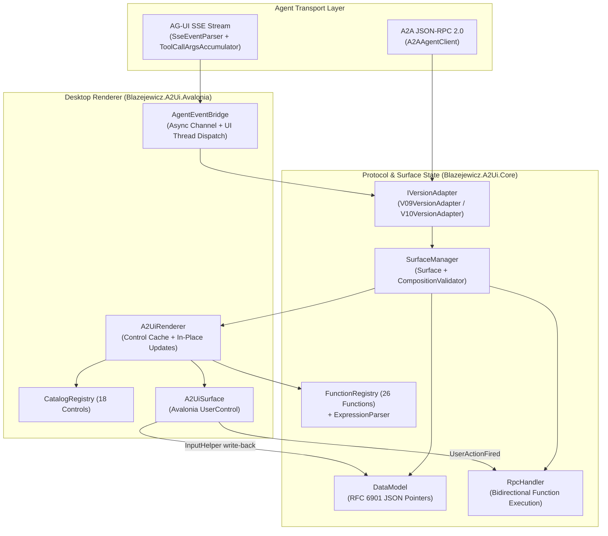

# Blazejewicz.A2Ui — .NET 10 SDK and Avalonia 12.1.5 renderer for A2UI

## Overview

`Blazejewicz.A2Ui` is a .NET (`net8.0` and `net10.0`) / C# 14 client SDK and native Avalonia `12.1.5` (`net10.0`) renderer implementing the [A2UI (Agent-to-User Interface)](https://github.com/google/A2UI) protocol (`v0.9`, `v0.9.1`, and `v1.0`).

A2UI is a declarative protocol that allows autonomous agents and large language models to send streaming, updatable user interfaces across process and network boundaries. `Blazejewicz.A2Ui` provides state management, data binding, protocol version normalization, validation, remote procedure call execution, and desktop UI controls for .NET applications.

## Capabilities

* Multi-version A2UI protocol support (`v1.0`, `v0.9.1`, `v0.9`) via `IVersionAdapter`, `SurfaceManager`, RFC 6901 JSON Pointer `DataModel`, `DynamicValue` bindings (`@path`, `@call`, `@index`, `ObjectValue`), 26 built-in functions (`FunctionRegistry`, `BuiltInFunctions`, `ExpressionParser`), bidirectional `RpcHandler`, and UAX 31 / composition validation.
* Native Avalonia `12.1.5` renderer (`Blazejewicz.A2Ui.Avalonia`) with 18 Basic Catalog controls (`CatalogRegistry`, `Controls/A2UiSurface.cs`), render-time version scoping, media URL security filtering, and in-place control updates.
* Streaming AG-UI integration (`Blazejewicz.AgUi.Protocol`) providing `SseEventParser` and `ToolCallArgsAccumulator` over `AGUI.Abstractions` (`1.0.1`).
* Connected A2A desktop client (`Blazejewicz.A2Ui.Avalonia.Shell`) built on `A2A.V0_3` (`1.0.0-preview4`), and offline specification replay harness (`Blazejewicz.A2Ui.Avalonia.Gallery`) with 79 `v0.9`, `v0.9.1`, and `v1.0` examples.
* Structured `[LoggerMessage]` logging and `ActivitySource` distributed tracing across all layers (see [`TELEMETRY.md`](TELEMETRY.md)).

## Architecture and rendering pipeline



### Threading, lifecycle, and validation guarantees

* **Threading and UI dispatch:** `AgentEventBridge` reads streaming events on a background channel loop and marshals surface mutations onto the Avalonia UI thread via `PostSafe` (`Dispatcher.UIThread.Post`), isolating subscriber exceptions. `SurfaceManager` synchronizes state mutations under `System.Threading.Lock` and raises lifecycle events (`SurfaceCreated`, `ComponentsUpdated`, `DataModelUpdated`, `SurfaceDeleted`) outside the lock to prevent deadlocks.
* **In-place control updates:** `A2UiRenderer` caches rendered controls by component ID and invokes `ICatalogEntry.Update()` (preserving focus on active input controls and resetting omitted properties) before falling back to `Create()`.
* **Data binding and template expansion:** `DataModel` evaluates RFC 6901 JSON Pointers (`~0`/`~1` unescaping and `v1.0` `null` deletion) and version-scoped `DynamicValue` expressions (`@path`, `@call`, `@index`, `ObjectValue`), expanding `List` `children.template` items with per-index scoped contexts.
* **Security and validation:** Enforces Unicode Standard Annex 31 (UAX 31) identifier syntax (`Uax31Validator`), component hierarchy rules and cycle detection (`CompositionValidator`), linear-time portable regular expression safety (`RegexSubset`), and media URL scheme allowlisting (`MediaSecurityHelper`).

## Catalog and built-in functions

### Basic Catalog controls (`CatalogRegistry` in `Blazejewicz.A2Ui.Avalonia`)

| Category | Components |
|----------|------------|
| Display | `Text`, `Image`, `Icon`, `Video`, `AudioPlayer`, `Divider` |
| Layout | `Row`, `Column`, `List`, `Card`, `Tabs`, `Modal` |
| Interactive | `Button`, `TextField`, `CheckBox`, `ChoicePicker`, `DateTimeInput`, `Slider` |

### Built-in functions (`FunctionRegistry` & `ExpressionParser` in `Blazejewicz.A2Ui.Core`)

`FunctionRegistry.CreateDefault()` registers 25 built-in functions and `ExpressionParser` evaluates `${...}` / `formatString` interpolation (26 functions total):

| Category | Functions |
|----------|-----------|
| Formatting | `capitalize`, `formatNumber`, `formatCurrency`, `formatDate`, `formatString`, `pluralize` |
| Arithmetic | `add`, `subtract`, `multiply`, `divide` |
| Comparison | `equals`, `not_equals`, `greater_than`, `less_than` |
| Logical | `and`, `or`, `not` |
| String | `contains`, `starts_with`, `ends_with` |
| Validation | `required`, `email`, `regex`, `length`, `numeric` |
| Action | `openUrl` |

## Solution structure

The solution (`A2Ui.slnx`) contains 9 projects:

| Project / Package ID | Target Framework(s) | Path | Description |
|----------------------|---------------------|------|-------------|
| `Blazejewicz.A2Ui.Core` | `net8.0;net10.0` | `src/A2Ui.Core/` | Core protocol models, version adapters, surface state, data model, 26 built-in functions, validation, and RPC handler |
| `Blazejewicz.AgUi.Protocol` | `net8.0;net10.0` | `src/AgUi.Protocol/` | AG-UI SSE stream parser and tool-call delta accumulator built on `AGUI.Abstractions` |
| `Blazejewicz.A2Ui.Avalonia` | `net10.0` | `src/A2Ui.Avalonia/` | Native Avalonia `12.1.5` renderer, 18 Basic Catalog controls (`CatalogRegistry`, `Controls/A2UiSurface.cs`), and event bridge |
| `Blazejewicz.A2Ui.Avalonia.Gallery` | `net10.0` | `samples/A2Ui.Avalonia.Gallery/` | Offline desktop gallery with 79 specification examples across `v0.9`, `v0.9.1`, and `v1.0` |
| `Blazejewicz.A2Ui.Avalonia.Shell` | `net10.0` | `samples/A2Ui.Avalonia.Shell/` | Connected desktop client communicating with A2A agents over JSON-RPC using `A2A.V0_3` |
| `Blazejewicz.A2Ui.Core.Tests` | `net8.0;net10.0` | `tests/A2Ui.Core.Tests/` | Unit and integration tests for core protocol, adapters, data model, and RPC |
| `Blazejewicz.AgUi.Protocol.Tests` | `net8.0;net10.0` | `tests/AgUi.Protocol.Tests/` | Unit tests for AG-UI event parsing and accumulator logic |
| `Blazejewicz.A2Ui.Avalonia.Tests` | `net10.0` | `tests/A2Ui.Avalonia.Tests/` | Headless renderer tests, component tests, and specification example verifications |
| `Blazejewicz.A2Ui.TestHelpers` | `net8.0;net10.0` | `tests/A2Ui.TestHelpers/` | Shared testing utilities, test logger provider, and activity listener |

## Build, test, and run

```bash
dotnet format A2Ui.slnx --verify-no-changes
dotnet build A2Ui.slnx --configuration Release
dotnet test A2Ui.slnx --configuration Release --no-build
dotnet run --project samples/A2Ui.Avalonia.Gallery/A2Ui.Avalonia.Gallery.csproj --configuration Release
dotnet run --project samples/A2Ui.Avalonia.Shell/A2Ui.Avalonia.Shell.csproj --configuration Release
```

## Documentation

* [`AGENTS.md`](AGENTS.md)
* [`RELEASE_NOTES.md`](RELEASE_NOTES.md)
* [`TELEMETRY.md`](TELEMETRY.md)
* [`samples/A2Ui.Avalonia.Gallery/README.md`](samples/A2Ui.Avalonia.Gallery/README.md)
* [`samples/A2Ui.Avalonia.Shell/README.md`](samples/A2Ui.Avalonia.Shell/README.md)
* [`specification/v0_9_1/docs/a2ui_protocol.md`](specification/v0_9_1/docs/a2ui_protocol.md) and [`specification/v1_0/docs/a2ui_protocol.md`](specification/v1_0/docs/a2ui_protocol.md)

## License

This project is licensed under the Apache 2.0 License. See [`LICENSE`](LICENSE) for details.
